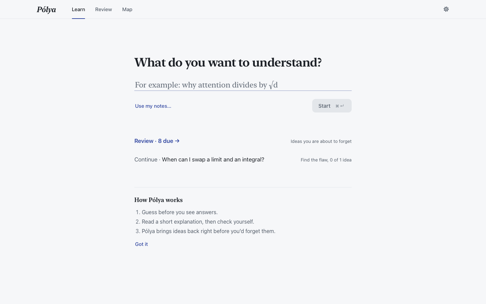
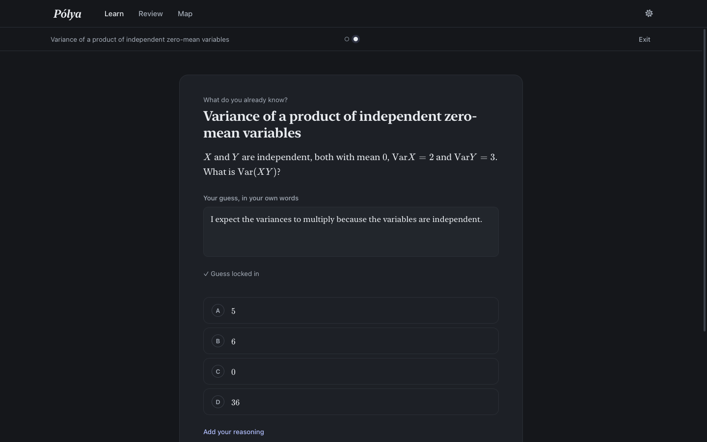
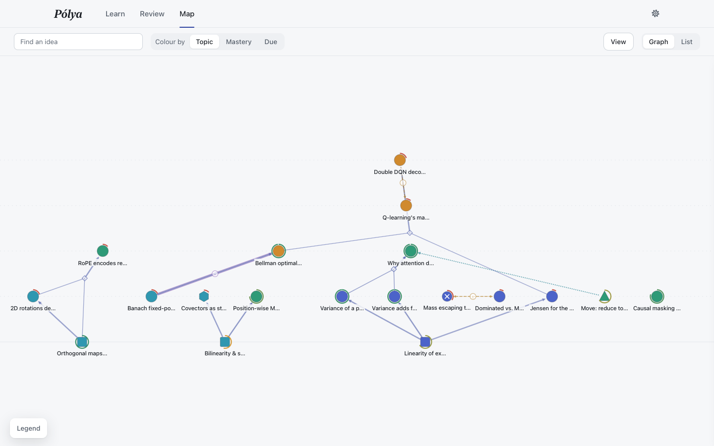

# Pólya

**Guess first. Check yourself. Review right before you forget.**

Pólya is a local-first learning companion for mathematics and machine-learning theory. It's named after George Pólya, whose *How to Solve It* taught a generation to guess, try the simple case, and look back. You tell it what you want to understand; it works out what you already know, teaches the gaps one small step at a time, and brings ideas back just before you'd forget them.



## How to use it

1. **Learn.** Type what you want to understand ("Why does attention divide by √d_k?") and press **Start**.
2. **Guess before you see the answers.** Each question asks for your own guess first. Press **Lock in guess** and the options appear. Pick one, say how sure you are, and **Check**.
3. **Read, then check yourself.** Explanations are short and start from the simplest case. Select any sentence to add a thought.
4. **Review.** Open **Review** and press **Start review**. Pólya picks the ideas you're about to forget and mixes topics together. **Challenge me** has two harder exercises: find the flaw in a proof, or explain an idea to a confused student.
5. **Map.** See everything you've learned as a graph of ideas and what they're built from. Click any idea to practise it.
6. **Read a paper.** Paste an arXiv link into Learn (or use **Read a paper…** for a PDF). See [Reading research papers](#reading-research-papers).

That's it. Everything else happens underneath; the **Details** link on each card shows why that step was chosen and how your answer was scored. **Settings → Advanced** turns on the full research dashboard.

| Question card | Map |
|---|---|
|  |  |

## Install

**Mac app** (macOS 13+, Apple silicon). You need [uv](https://docs.astral.sh/uv/) and Node 18+ to build it:

```bash
git clone https://github.com/chow-n/polya && cd polya
make bundle        # builds the self-contained Pólya.app (about 100 MB) into /Applications
open -a Pólya
```

**In a browser** (macOS or Linux):

```bash
make install && ./start.sh      # http://localhost:5173
```

Your data lives in `~/Polya/`: `harness.db` plus `workspace/` holding notes, problem sets and `scratch.tex`. That folder is shared by the app, `./start.sh` and the `./polya` command-line tool:

```bash
./polya status     # what you know, what's fading, how well calibrated you are
./polya due        # what to review next
./polya graph      # your ideas by depth
./polya scratch    # print / edit / watch workspace/scratch.tex (saves stream into the app live)
./polya eval       # how well Pólya's model predicts your answers, and your difficulty target
```

### AI engine (optional)
Pólya works with no API key at all:

1. With a key (set in Settings or the environment: `ANTHROPIC_API_KEY`, `OPENAI_API_KEY`, `GEMINI_API_KEY` or `OPENROUTER_API_KEY`), questions and feedback are generated for any topic.
2. Without a key, it uses your local `claude` CLI if installed, then the [Codex CLI](https://github.com/openai/codex) signed in with your ChatGPT plan (**ChatGPT via Codex** in Settings picks it first). Expect 10–40 s per step.
3. Otherwise a built-in engine uses hand-written content for the 20 starter topics, plus SymPy for checking math.

If an engine fails mid-step (logged out, rate-limited, timed out), the step falls through to the next one; **Details** shows which engine wrote it. Your engine choice is remembered in `~/Polya/prefs.json`; keys never are.

Voice: inside the Mac app, dictation runs on-device with Apple's speech recognizer. In a browser, it uses the browser's speech recognition, or Deepgram if `DEEPGRAM_API_KEY` is set.

## How it adapts

Pólya aims for you to get about 85% of questions right: hard enough to stretch you, easy enough to keep going. It tracks your recent success rate, weighting the last ten graded answers with the newest counting most. When you're well above the target, steps get bigger and review problems get harder (plain → disguised notation → mixed → trick questions). When you're well below it, steps and problems get easier. A clear miss still drops back to small steps and adds a review of what that idea builds on. You can set the target to 80%, 85% or 90% in **Settings**; the reasoning behind each change shows under **Details** on the card.

Pólya also checks its own model. Before each graded answer it records how likely it thought you were to get it right. **Settings → Advanced** (or `./polya eval`) scores those predictions, using log-loss, Brier score, AUC and calibration, against two simple baselines: your overall accuracy and your accuracy on that idea. Until about 50 answers the numbers are too noisy to mean much. `python -m backend.simulate` runs both the model scoreboard and the target-tracking on synthetic learners.

## Reading research papers

Paste an arXiv link (or id) into Learn and press **Read paper**, or choose a PDF under **Read a paper…**. Pólya:

1. **Reads the paper from its LaTeX source** when arXiv has it (exact math, theorem environments, every `\cite` with its sentence and section); otherwise from the PDF.
2. **Maps it** with your AI engine: its definitions, assumptions, claims and main result, how they connect, its notation, and the background it assumes, matched against the ideas you already have. Every idea quotes one sentence of the paper; quotes that cannot be found in the paper are dropped. Mapping takes one to three minutes.
3. **Reads it with you in three passes.** Skim: guess the main result from the abstract and section list. Then quick probes on the background (what you know is skipped, gaps are taught), then the paper's ideas in order, each card quoting the passage it comes from. Last, critical reading: find the flaw planted in the paper's own key argument, then explain the main result to a sceptical student until you have stated every assumption.
4. **Tracks down sources.** *Read next* ranks the references by where the paper cites them (method and proof sections count most) and by the ideas you missed; *Builds on this* lists the most-cited later papers (surveys marked); *Explainers* finds surveys and tutorials on your gaps. Any arXiv source opens with **Read this paper**.
5. **Keeps it.** The paper's ideas join your reviews, and each paper shows how much of it you understand.

Without an AI engine the paper is still fetched and parsed, and its theorem blocks become a partial map. Paper metadata goes to arXiv, Semantic Scholar and OpenAlex; the paper's text goes only to the AI engine you chose. Files live in `~/Polya/workspace/papers/`.

## Why it works, and the limits

Each mechanism is based on a well-replicated finding:

| What Pólya does | Why |
|---|---|
| Asks for your guess before showing options | Pretesting effect: Kornell, Hays & Bjork (2009); Richland, Kornell & Kao (2009) |
| Brings ideas back when recall gets hard (R ≈ 0.70–0.85) | Desirable difficulties: Bjork & Bjork (1992); FSRS-style memory model |
| Tests rather than re-shows | Testing effect: Roediger & Karpicke (2006) |
| Mixes topics in review | Interleaving: Rohrer & Taylor (2007) |
| Pays extra attention to confident mistakes | Hypercorrection: Butterfield & Metcalfe (2001) |
| Can let you struggle before teaching | Productive failure: Kapur (2008) |
| Tells you whether your confidence is accurate | Calibration, Brier score decomposition: Murphy (1973) |
| Judges *how* you reasoned, not just the answer | Bayesian knowledge tracing (Corbett & Anderson, 1994), extended with reasoning quality |
| Keeps you succeeding about 85% of the time | Wilson et al. (2019), derived for machine learners; a tunable heuristic for people |
| Reads papers in passes, guessing first | Three-pass reading: Keshav (2007); the pretesting effect again |

**Honest caveats.** This is a research prototype, not a validated tutor.

- The memory and mastery constants are hand-set rather than fitted to your history. The scoreboard shows how much that costs.
- The 85% target comes from machine-learning theory, and its evidence for humans is indirect.
- The "most informative question" score is an approximation.
- Without an AI engine, reasoning quality is judged by concept coverage, which can be gamed.
- No learner study has been run.

## For developers

```
backend/   FastAPI + SQLite hypergraph of ideas
  cognitive_math.py   memory model, knowledge tracing, belief propagation, question selection, calibration, pacing
  agents/             session state machine, 8 helper agents (math checker, diagnosis, counterexamples, …), offline content
  papers/             arXiv/PDF ingest, LaTeX parsing, paper maps, Semantic Scholar/OpenAlex sources
frontend/  React + TypeScript (Vite), KaTeX, Canvas graph, Web Audio voice/prosody
macos/     native app launcher (pywebview), py2app (`make app`) and PyInstaller (`make bundle`) builds
```

- `make test` runs the backend suite (deterministic engine, offline); `make build` builds the frontend.
- Design docs:
  - [`ARCHITECTURE_SPEC.md`](ARCHITECTURE_SPEC.md) is the original full spec, written under the earlier name LearnHarness.
  - [`docs/API.md`](docs/API.md) is the REST/WebSocket contract.
  - [`docs/specs/`](docs/specs/) holds the decision records.
- Environment variables use the `POLYA_` prefix (`POLYA_HOME`, `POLYA_LLM`, …); the old `LEARNHARNESS_` prefix still works.
- The SymPy checker runs in a separate process with blocked imports, no file access and a 5 s timeout. It is a guard rail, not a security boundary, so keep Pólya local.

## Status

- v0.1: web app.
- v0.2: native macOS app.
- v0.3: renamed Pólya, with a minimalist interface.
- v0.4: model scoreboard and the 85% difficulty target.
- v0.5: reading research papers (map, guided passes, ranked sources); the Codex engine and engine fallback.
- Next: comparing your review of a paper with its real peer reviews, citation maps across papers, and fitting the memory model to your own history.

## License

MIT
