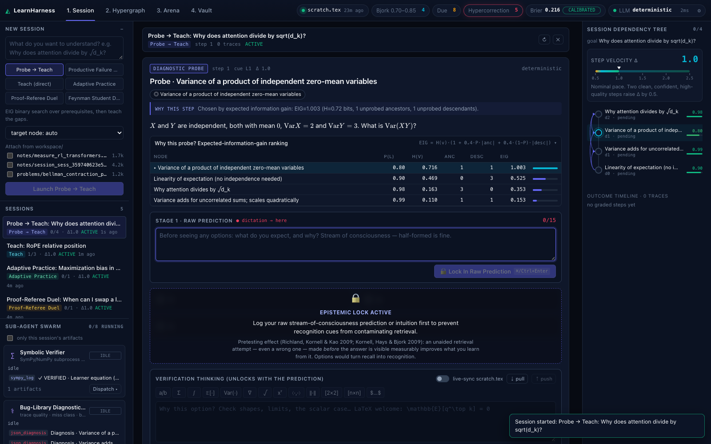
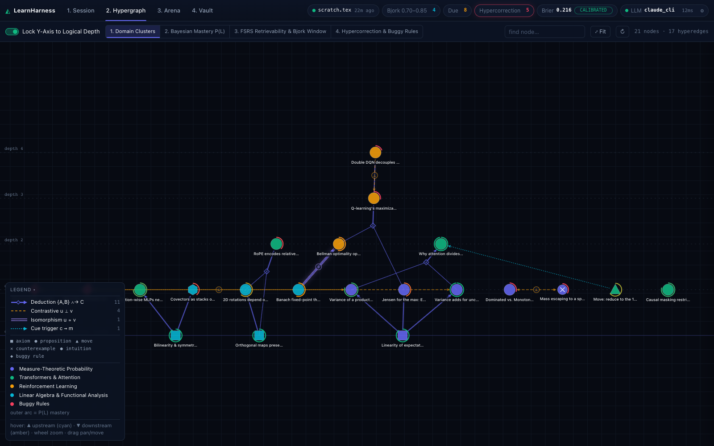
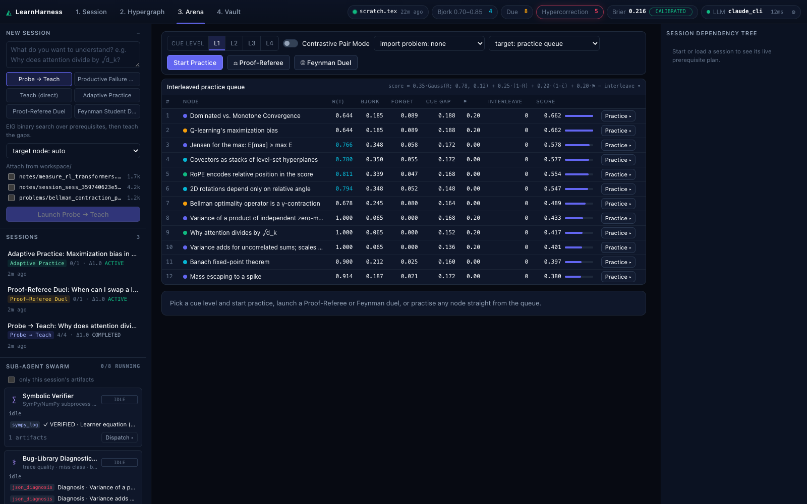

# LearnHarness

A local-first learning harness that treats what you know as **hidden state**. It watches how you reason, not just whether you're right, and chooses the next step to make you think hard at the right moment.

It models learning as a partially observable Markov decision process (POMDP). Ideas are nodes in a hypergraph, and "A and B imply C" is a hyperedge. Every answer you give is evidence about your hidden knowledge, and the next step is chosen from the updated beliefs.



## What a session looks like

1. **Probe.** It asks about the prerequisite whose answer tells it the most. Mastering an idea is evidence you know what it's built from; failing it is evidence that what's built on it is out of reach. That lets it skip what you already know.
2. **Predict before you see options.** Multiple-choice options stay locked until you write your own prediction (at least 15 characters).
3. **Read, then check.** Explanations are short (under 180 words) and start from a concrete base case. You can highlight any sentence or equation and attach a "thinking while reading" note. Then a transfer check uses disguised notation.
4. **Practice and duels.** Cue-demand problems never name the theorem. A five-rung Socratic hint ladder runs from a shape check to a worked analog. In a Proof-Referee duel you find the one flawed step in a proof. In a Feynman duel you convince a simulated student who holds a misconception.

Behind every answer:

- **It grades the reasoning as well as the answer.** It reads three channels: the locked prediction, notes taken while reading, and post-answer reasoning, plus voice prosody (latency, pauses, hedge words). A right answer reached by guessing earns little mastery credit. A wrong answer caused by unfamiliar notation is penalised less than a structural misconception.
- **Misconceptions become part of the graph.** Recurring misconceptions are saved as `BUGGY_RULE` nodes. Over-general claims ("always", "for every…") get a counterexample, checked with SymPy, attached as a node.
- **Pace adapts.** The step size Δ grows after clean, confident solves. A failure or a confident error drops it to the smallest step and inserts a remedial prerequisite step before trying again.
- **Review timing.** A memory model tracks how well you'd recall each node right now. Practice targets the point just before forgetting, and topics are interleaved across domains.

| Hypergraph (Y-axis locked to logical depth) | Interleaved practice queue |
|---|---|
|  |  |

## The science, and its limits

Each mechanism is based on a well-replicated finding:

| Mechanism | Finding |
|---|---|
| Predict before options; probe before teaching | Pretesting effect: Kornell, Hays & Bjork (2009); Richland, Kornell & Kao (2009) |
| Spaced reviews in the 0.70–0.85 recall window | Desirable difficulties and the new theory of disuse: Bjork & Bjork (1992); FSRS-style memory model |
| Retrieval practice throughout | Testing effect: Roediger & Karpicke (2006) |
| Interleaved practice queue | Rohrer & Taylor (2007) |
| Hypercorrection flag with a stability bonus | Butterfield & Metcalfe (2001) |
| Productive Failure mode | Kapur (2008) |
| Calibration badge: Brier score split into reliability − resolution + uncertainty | Murphy (1973) |
| Mastery estimate (BKT) weighted by reasoning quality | Corbett & Anderson (1994), extended here |

**Honest caveats.** This is a research prototype, not a validated tutor.

- The constants for the memory and mastery models (the 0.78 target, the 1.25× hypercorrection bonus, slip and guess rates) are hand-set. Real FSRS fits about 19 parameters to your own history.
- The probe score is an approximation of expected information gain, not exact mutual information.
- Without an LLM, reasoning quality is judged by keyword and concept coverage, which can be gamed.
- Productive failure helps most with conceptual material and can backfire for complete novices.
- No learner study has been run.

## Quick start

Requirements: macOS or Linux for the web app (the Mac app needs macOS 13+ on Apple silicon), Python 3.11+ (`uv` recommended), Node 18+.

```bash
git clone https://github.com/chow-n/learn-harness && cd learn-harness
make install          # backend venv + frontend deps
./start.sh            # FastAPI :8000 + Vite :5173, waits for health checks
```

Open http://localhost:5173. Data lives in `~/LearnHarness/` (override with `LEARNHARNESS_HOME`). On first start the database is seeded with 20 nodes across linear algebra, measure-theoretic probability, transformers and reinforcement learning, along with 16 hyperedges, 3 interactive demos and 3 example sessions. If port 5173 is taken, run `LEARNHARNESS_WEB_PORT=5174 ./start.sh`.

```bash
./harness-cli status   # mastery, Bjork window, calibration decomposition
./harness-cli due      # due list at 90% desired retention
./harness-cli graph    # hypergraph by logical depth
./harness-cli scratch  # print / edit / watch workspace/scratch.tex
make test              # 34 backend tests (deterministic engine, offline)
```

`workspace/scratch.tex` is watched live: save it in your editor and it streams into the UI. Notes and problem sets in `workspace/notes` and `workspace/problems` are parsed (`\begin{theorem}`, `\begin{problem}`, …) for retrieval and problem import.

## Mac app

```bash
make bundle   # self-contained LearnHarness.app (embedded Python, ~100 MB) → /Applications
make app      # dev variant: repo-backed app (py2app alias) → ~/Applications; code edits show on relaunch
```

- **One process, one window.** It runs on a random localhost port, so it won't clash with other dev servers. Cold start is about 1.5 s.
- **Shared data home.** The app, `./start.sh` and `./harness-cli` all use `~/LearnHarness/` (`harness.db` plus `workspace/`). The repo-backed variant copies an existing repo database there on first launch; it copies and never moves.
- **On-device dictation.** Inside the app, voice dictation uses Apple's speech recognizer with no API key. macOS asks for microphone and speech permission on the first mic use.
- **Menu.** Open Workspace Folder, Edit scratch.tex in Terminal, Reveal Data Folder, Show App Log, Reload, and Open in Browser.
- **Signing.** The app is ad-hoc signed for the Mac that built it; it is not notarized. Build it yourself from source.

## LLM engines (all optional)

It works with no API key at all. Resolution order:

1. An API key, set in the environment or in the settings dialog: `ANTHROPIC_API_KEY`, `OPENAI_API_KEY`, `GEMINI_API_KEY` or `OPENROUTER_API_KEY`.
2. The local `claude` CLI (`claude -p --output-format json`), if installed. Expect 10–40 s per generated step.
3. A deterministic engine: a hand-written content bank for the seed nodes, template generation for imported nodes, and the SymPy verifier.

Voice dictation uses Deepgram (`DEEPGRAM_API_KEY`, `nova-3`) when a key is set, and otherwise the browser's SpeechRecognition. The prosody meter uses the Web Audio API either way.

## Architecture

```
backend/   FastAPI + SQLite (WAL) hypergraph
  cognitive_math.py   memory model (FSRS-style), BKT, belief propagation, probe selection, Brier/Murphy, Δ-controller
  agents/             orchestrator (6-mode state machine), 8 sub-agents, prompts, offline content bank
  tools.py            sandboxed SymPy/NumPy verifier, workspace search, LaTeX parsing, arXiv lookup
frontend/  React + TypeScript (Vite), hand-written Canvas 2D hypergraph, KaTeX, Web Audio prosody tracker
workspace/ your scratchpad, notes and problem sets
```

The full design spec is in [`ARCHITECTURE_SPEC.md`](ARCHITECTURE_SPEC.md), the REST/WebSocket contract in [`docs/API.md`](docs/API.md), and decision records in [`docs/specs/`](docs/specs/).

The SymPy verifier runs code in a separate process with blocked imports, no file access and a 5 s timeout. It is a guard rail, not a security boundary: run LearnHarness locally only.

## Status

- v0.1.0: web app.
- v0.2.0: native macOS app, repo-backed (`make app`) and self-contained (`make bundle`), with on-device dictation (see [`docs/specs/mac-app/SPEC.md`](docs/specs/mac-app/SPEC.md)).
- Next: fitting the memory and mastery parameters to your own trace history.

## License

MIT
